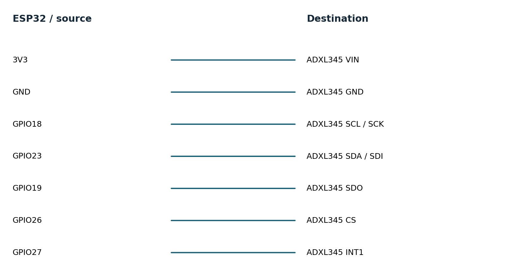

# Machine condition monitor hardware guide

No hardware was connected. This design is ready for a later bench build. Use a classic ESP32-WROOM DevKitC; GPIO16/17 can be unavailable on WROVER variants.

## Bill of materials

| Component | Qty | Cost |
|---|---|---|
| ESP32 DevKitC WROOM 4 MB | 1 | USD 10-18 estimate |
| Adafruit ADXL345 1231 | 1 | USD 17.50 observed |
| USB cable, breadboard, jumpers, rigid mount | 1 set | USD 5-10 estimate |

Costs are USD planning estimates except the cited sensor prices observed on 2026-11-11. Tax, shipping, computer and test equipment are excluded. One board can be reused across the portfolio.

## Wiring

| ESP32 or source | Destination | Notes |
|---|---|---|
| 3V3 | ADXL345 VIN | Use the specified 3.3 V compatible breakout |
| GND | ADXL345 GND | Common reference |
| GPIO18 | ADXL345 SCL / SCK | SPI clock |
| GPIO23 | ADXL345 SDA / SDI | SPI MOSI |
| GPIO19 | ADXL345 SDO | SPI MISO |
| GPIO26 | ADXL345 CS | Active low; avoids boot strap pins |
| GPIO27 | ADXL345 INT1 | Watermark / overrun interrupt |

Use 3.3 V signaling, short leads and a common ground. Do not connect GPIOs directly to mains equipment or industrial 5/12/24 V outputs. Start with a bench pulse source or isolated low-voltage rig. Use USB power for initial bring-up; battery charging and protection are outside this prototype.

## Tools for physical validation

- Required for assembly: data-capable USB cable, breadboard/jumpers, multimeter; soldering tools if breakout headers are not fitted.
- Required for timing claims: logic analyzer with at least 10 MHz sampling for 2 MHz SPI; 20 MHz or more is preferable.
- Required for pulse fidelity: calibrated function generator or second MCU, checked with a logic analyzer.
- Required for power claims: current profiler or suitable shunt plus oscilloscope, bench supply and a measured battery specification.
- Optional firmware debugging: ESP-Prog JTAG adapter; serial diagnostics suffice for the initial experiments.

## Acceptance experiments

1. Capture INT1, CS and a temporary analysis-toggle GPIO with a logic analyzer for 60 s. Count data samples; target 800 Hz within the sensor clock tolerance, no unexplained sequence gaps, and window compute below 10 ms. Record p50/p95/p99 service latency.

2. Disconnect sensor power for 5 s. Record first SENSOR_FAULT timestamp and first complete valid window after reconnection. Target recovery below 2 s; repeat 20 times. Force a sampler delay >40 ms to show a FIFO overrun and window reset.

3. In a temporary test build, suppress only the sampler watchdog reset while other tasks keep running. Confirm reboot, reset reason and recovery. Remove injection afterward. Cut power during NVS writes and check startup state remains valid or reports absent.
