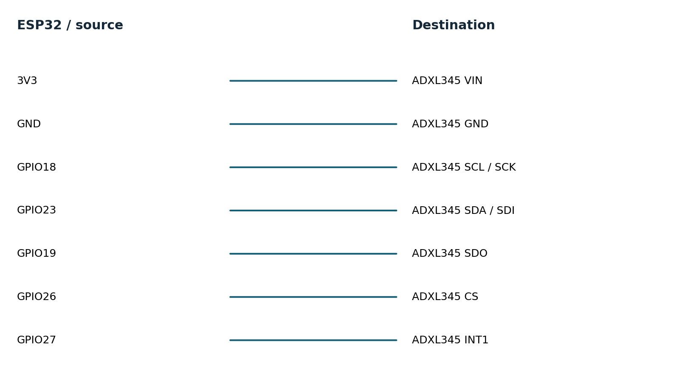
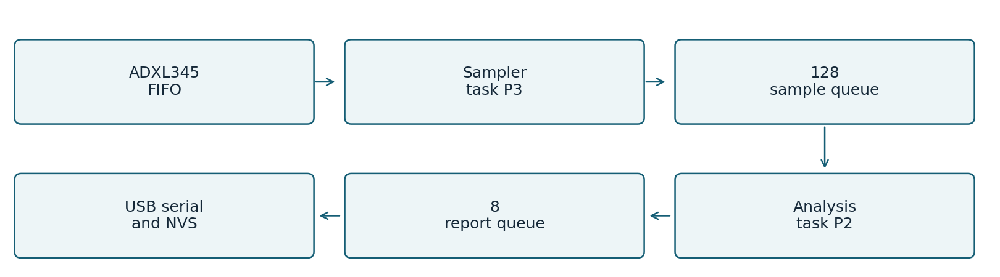
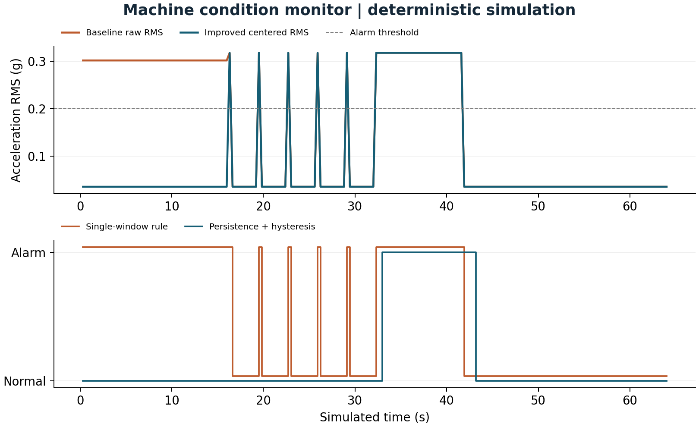

# Machine condition monitor

Flagship project for sustained vibration change detection

Machine condition monitor

Flagship project for sustained vibration change detection

Engineering report  |  11 November 2026  |  AI-assisted implementation

A workshop technician needs to notice sustained changes in a small fan or motor without treating a single knock or a changed mounting angle as a fault. This bench prototype measures one accelerometer axis and reports a qualified alarm. It does not identify bearing defects or certify machine safety.

Verified scope: portable C++ tests and deterministic simulations, host integration where applicable, and actual ESP32 cross-compilation. No board was flashed, sensor exercised, or physical measurement collected.

## Requirements and acceptance

| ID | Target established before testing | Verification status |
| --- | --- | --- |
| F1 | 800 Hz ADXL345; 16-sample watermark; SPI 2 MHz | Driver mock passes; timing needs board |
| F2 | 256 samples; alarm >0.20g for 3 windows; clear <0.14g for 5 | Shared-core tests and trace pass |
| F3 | Invalidate gaps; 100 ms silence fault; retry in 1 s | Core gap tests pass; physical recovery pending |
| F4 | 128 samples + 8 reports; watchdog 5 s; <10 ms compute | Bounded implementation; target timing pending |
| F5 | Serial diagnostics; latest transition persisted at most once/minute | Compiled adapter; physical NVS pending |

Targets remain targets until their corresponding environment is tested. This report distinguishes synthetic behavior, host wall-clock execution and linker resource counts. Hardware timing, current, electrical recovery and watchdog reset remain pending.

## Hardware and wiring

Target: classic ESP32-WROOM-32 DevKitC with 4 MB flash. One board can be reused across the three projects. Use the specified 3.3 V interfaces; WROVER pin availability differs.

| Component | Qty | Planning cost |
| --- | --- | --- |
| ESP32 DevKitC WROOM 4 MB | 1 | USD 10-18 estimate |
| Adafruit ADXL345 1231 | 1 | USD 17.50 observed |
| USB cable, breadboard, jumpers, rigid mount | 1 set | USD 5-10 estimate |

Sensor prices were observed on the cited supplier pages on 11 November 2026. Other costs are estimates in USD, excluding tax, shipping and measurement instruments.

Connection diagram names signal endpoints, not physical header positions. Consult the board silk screen. Use a common ground and short leads. Start with a low-voltage bench setup; industrial-voltage inputs need a suitable interface. See hardware.md for pin notes and instrument requirements.

## Firmware architecture and decisions

SPI belongs only to the sampler. The GPIO interrupt sends a FreeRTOS task notification; it never reads the bus, allocates memory, prints, or calculates signal features. A 10 ms fallback poll prevents a missed interrupt from stopping acquisition.

Queue entries are copied values. The sampler assigns sequence numbers before enqueueing, and marks the next accepted sample after a queue drop. The processor detects discontinuity, discards its partial window and enters SENSOR_FAULT. Complete fresh windows are required before normal detection resumes.

The FIFO is stream mode, 32 entries, with a 16-entry watermark. At 800 Hz it holds only 40 ms, so long flash stalls can still cause overflow. They are reported, not concealed. Six-byte SPI reads consume all three axes to advance FIFO correctly; only x is analyzed. A 5 microsecond gap is left between FIFO reads.

Two-pass RMS uses a double-precision mean and centered energy. This favors numerical behavior over speed; no target acceleration is claimed. Single-precision or fixed-point optimization is an experiment, not an implemented improvement.

The task watchdog observes sampling, analysis and the Arduino output task. Queues and stacks are allocated at startup and checked. Atomic counters hold cross-task drop counts. NVS is owned by the output task and writes only a rate-limited latest state, not a complete event history.

### Ownership of the implementation

Project code implements drivers, calculations, state machines, queue/parser policy, tests and tools. Arduino ESP32 provides the peripheral HAL and startup; ESP-IDF provides FreeRTOS, NVS, watchdog and sleep services. The environmental gateway uses SQLite transactions. Official GitHub drivers were studied as references; they were not copied into these custom headers.

## Testing and evidence

| Requirement | Test or experiment | Result |
| --- | --- | --- |
| F1 | Identity, register settings, invalid FIFO count, signed sample, failed SPI mock | PASS host |
| F2 | Analytic sine RMS / crest; constant and empty window; NaN; hysteresis | PASS host |
| F3 | Missing sequence, flagged overflow, partial-window invalidation, wrap | PASS host |
| F3/F4 | FIFO and software queue blackout model; ring bounds; host soak | PASS host model |
| F1/F4 | Real FIFO cadence, ISR duration, FreeRTOS jitter and watchdog reset | PENDING hardware |
| F5 | Power cut during state write; restart diagnostic; flash stall effect | PENDING hardware |

Host tests compile the same portable headers used by target firmware. Strict compiler warnings, AddressSanitizer and UndefinedBehaviorSanitizer are enabled in separate test runs. Bus mocks validate transactions and selected faults; they do not reproduce analog behavior or peripheral timing.

PASS 290 assertions: features, hysteresis, gaps, ring, mocked SPI driver

Recorded extended loop: 60.000043 seconds and 75,050,939 workload iterations. This is one short host stress run, not a field endurance qualification. Three additional approximately five-second repetitions provide throughput variability.

Evidence is retained in tests.txt, sanitizers.txt, trace.csv, soak.json, extended-soak.json and build logs. test-matrix.csv maps requirements to results. Original failures remain in initial-tests.txt. No hardware test is marked passed on the strength of a simulation.

## Baseline and improved performance

| Metric | Baseline | Improved | Unit |
| --- | --- | --- | --- |
| DC offset RMS error | 0.2667 | 1.6e-09 | g |
| Isolated spike alarm count | 5 | 0 | alarms |
| Sustained alarm delay | 0.32 | 0.96 | s |

The improved rule removes DC sensitivity and rejects the five isolated bursts. That costs response time: the aligned sustained-step alarm moves from 0.32 to 0.96 seconds, an added 0.64 seconds. This is a useful tradeoff, not a claim that every metric improved. The test does not establish real machine detection accuracy.

## Measurement definitions and limitations

### M01 DC offset RMS error

Definition: Mean absolute error against amplitude/sqrt(2). Method: Same analytic sine through features(remove_dc=false/true). Workload: 50 Hz sine, 0.05 g peak, +0.3 g DC; 800 Hz sampling. Samples: 50 windows x 256 samples.

Environment: deterministic host simulation of shared C++ logic. Baseline: 0.2667; improved: 1.6e-09 g. Limits: Ideal float input; no sensor calibration, quantization or noise.

### M02 Isolated spike alarm count

Definition: Alarm-positive windows on isolated one-window bursts. Method: Count flags in identical trace. Workload: Five 0.45 g one-window sines separated by quiet windows. Samples: 5 injected bursts.

Environment: deterministic host simulation of shared C++ logic. Baseline: 5; improved: 0 alarms. Limits: Synthetic event test only; not field false-alarm rate.

### M03 Sustained alarm delay

Definition: First alarm window end minus aligned signal onset. Method: Find first positive flag after sustained-step onset. Workload: 0.45 g sine starting at a window boundary. Samples: 30 sustained windows.

Environment: deterministic host simulation of shared C++ logic. Baseline: 0.32; improved: 0.96 s. Limits: Simulation time; arbitrary onset can delay more; no scheduling or UART latency.

### Resource counts and host execution

M08 Firmware flash footprint: 290,069 bytes. Parse target linker size report. 1 target build. Baseline: not measured. No baseline firmware image; static RAM excludes runtime heap, queues and task stacks.

M09 Firmware static RAM: 22,192 bytes. Parse target linker size report. 1 target build. Baseline: not measured. No baseline firmware image; static RAM excludes runtime heap, queues and task stacks.

M10 Host core throughput: 1,257,469.7569 units/s. steady_clock around compiled C++ core; observable checksum. 3 repetitions, durations 5.000036s,5.000018s,5.000015s. Baseline: not measured. Desktop benchmark only; no baseline speedup claim; min=1254961.6792303994 max=1263295.694501069.

Target build: Xtensa GCC 8.4.0, Arduino ESP32 2.0.17 and PlatformIO Espressif platform 6.9.0. Host: macOS-26.2-arm64-arm-64bit; C++17 -O2; portable application core. The complete nine-field metric records and machine-readable values are in evidence/metrics.csv and metrics.json. Physical latency, stack use, CPU load, current and battery life are not reported as measured.

## Failures recovery and remaining risks

### Observed failures and review fixes

The original feature and driver test suite passed. Review identified that persistent state was written but never shown at startup; startup diagnostics now read it. The driver cannot detect an arbitrary corrupt SPI sample because ADXL345 data frames have no CRC. Identity, FIFO bounds and silence checks catch only a subset of electrical failures.

### Current limitations

Only one axis and time-domain features are used. The synthetic trace contains known sines and ideal offsets, not labeled machine recordings. False-alarm counts apply only to this trace. No FFT, trained classifier, wireless dashboard, production enclosure, or protective shutdown is claimed. The latest transition may be lost before its one-minute persistence interval. A full report queue can lose diagnostic rows, with a counter reporting that loss.

### Hardware acceptance experiments

1. Capture INT1, CS and a temporary analysis-toggle GPIO with a logic analyzer for 60 s. Count data samples; target 800 Hz within the sensor clock tolerance, no unexplained sequence gaps, and window compute below 10 ms. Record p50/p95/p99 service latency.

2. Disconnect sensor power for 5 s. Record first SENSOR_FAULT timestamp and first complete valid window after reconnection. Target recovery below 2 s; repeat 20 times. Force a sampler delay >40 ms to show a FIFO overrun and window reset.

3. In a temporary test build, suppress only the sampler watchdog reset while other tasks keep running. Confirm reboot, reset reason and recovery. Remove injection afterward. Cut power during NVS writes and check startup state remains valid or reports absent.

The engineering-review.md companion records resource budgets, failure modes and release gates. A change should update its requirements, test matrix and comparison trace together; preserve the original workload so before/after values remain comparable.

## Reproduce demonstrate and explain

Prerequisites: C++17 compiler, Python 3.9 or later, and a terminal. The simulation and C++ tests require no board or paid service. From the project directory:

    sh tools/test.sh
    sh tools/sanitize.sh
    sh tools/simulate.sh > evidence/trace.csv
    python3 -m venv .venv
    .venv/bin/pip install -r tools/requirements.txt
    .venv/bin/python tools/benchmark.py --rerun
    .venv/bin/python tools/figures.py
    .venv/bin/pio run -e esp32dev -e simulated
On Windows, activate the virtual environment and use its Scripts executables; run shell scripts through WSL or a compatible shell. Flash only when the matching board is attached: pio run -e esp32dev -t upload --upload-port PORT. Use pio device monitor --port PORT -b 115200. The simulated firmware environment generates inputs on a physical ESP32; the host simulator runs on the computer.

### Demonstration sequence

1. Run sh tools/test.sh and identify the gap/overflow assertions.

2. Run sh tools/simulate.sh and open evidence/benchmark.png.

3. Explain the offset region, five isolated spikes and sustained step. Show the delayed alarm as a tradeoff.

4. Open src/main.cpp and trace one interrupt through the queues. End by stating that target timing is pending hardware.

The mentor-guide.md companion contains a beginner explanation, code walkthrough, ten interview questions with answers, independent exercises and three evidence-based resume bullets. Development was AI-assisted; no independent hardware work or production deployment experience is implied.

### Primary references

ADXL345 Rev G datasheet: https://www.analog.com/media/en/technical-documentation/data-sheets/adxl345.pdf

SHT3x DIS version 7 datasheet: https://sensirion.com/media/documents/213E6A3B/63A5A569/Datasheet_SHT3x_DIS.pdf

ESP32 DevKitC guide: https://docs.espressif.com/projects/esp-idf/en/v4.4.7/esp32/hw-reference/esp32/get-started-devkitc.html

ESP32 watchdog API: https://docs.espressif.com/projects/esp-idf/en/v4.4.7/esp32/api-reference/system/wdts.html

Pinned platform definition: https://github.com/platformio/platform-espressif32/blob/v6.9.0/platform.json

See references.md for the pinned GitHub driver study, supplier links and implementation attribution.

